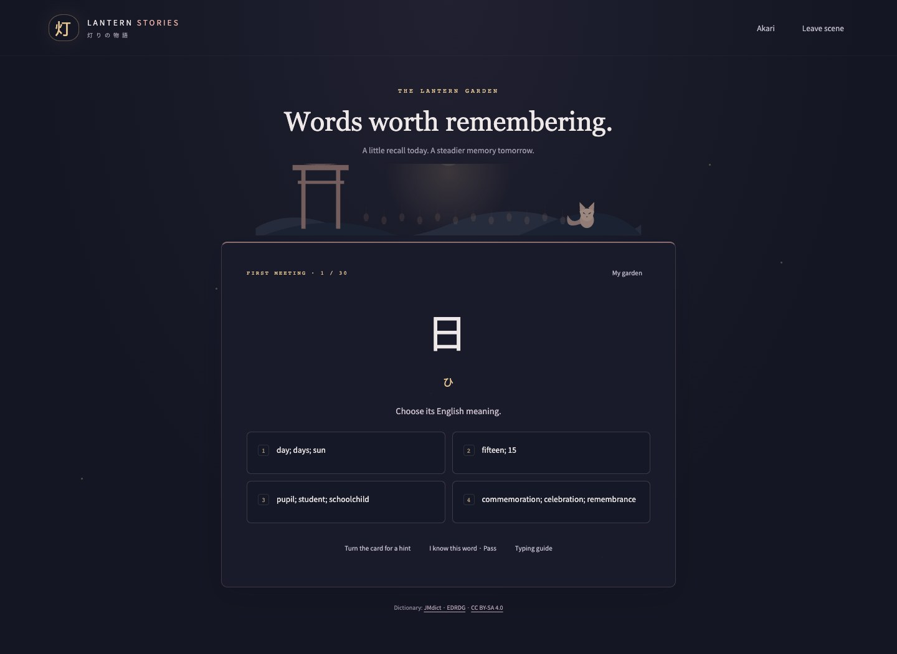
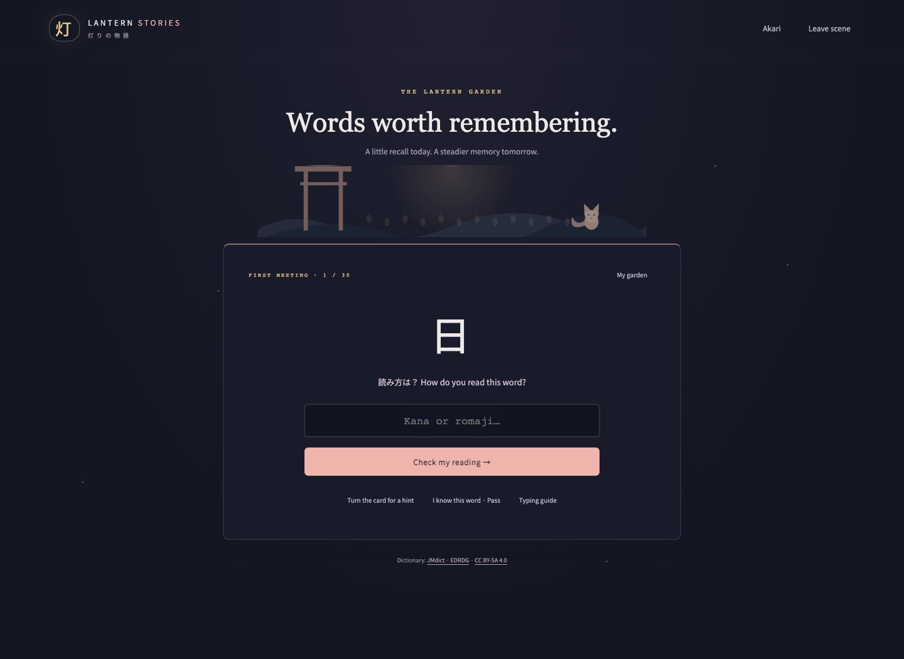
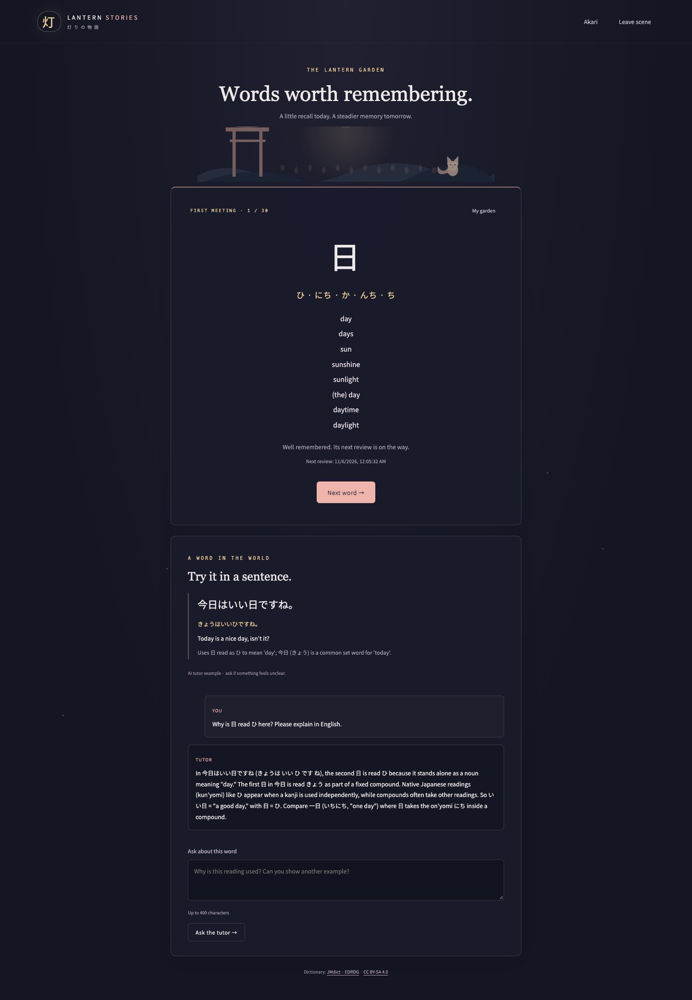

# Lantern Stories · 灯りの物語

A Japanese-learning RPG and a personal kanji garden. Choose **Yuri**, **Haruka** or **Hana**, share a predefined or custom scene, and practice the Japanese words you exchange. In the garden, recall kanji readings, choose dictionary meanings, and build a lasting learning record.

**HTML / CSS / JavaScript + Node.js and SQLite. No npm dependencies, native SDKs, Cangjie, Huawei tools, SDL or build step.** Art, fonts, input mappings and a 1,200-word dictionary deck are included.

Current version 3 screenshots, captured from the running application on **2026-11-05**. The account shown is a temporary demonstration account.


## Run

| Platform | Start |
| --- | --- |
| **Windows x86_64** | Double-click **`run.bat`** |
| macOS | Double-click **`run.command`**, or run `./run.sh` |
| Linux | Run `./run.sh` |
| Node.js **22.13+** installed | `npm start`, or `node server.mjs --open` |

Open **http://127.0.0.1:8787** in a current Edge, Chrome, Firefox or Safari. Keep the terminal open; Ctrl+C stops the server. Use the same address consistently (`127.0.0.1` or `localhost`) so the browser keeps the account cookie for that host.

The launchers reuse a compatible Node installation or download official **Node.js 22.23.1**, verify its SHA-256 against the official checksum list, and extract it into ignored `.tools/`. The first automatic download needs access to `nodejs.org`. Afterward the quiz and sample chapters work offline. No `npm install` is needed. Windows uses built-in PowerShell; macOS/Linux use curl, tar and shasum/sha256sum. If downloads are blocked, install Node.js 22.13+ yourself. On macOS, a ZIP download may need `chmod +x run.sh run.command` once before launching from Terminal.

To try the game without an API key, choose **Sample chapter**. Create a local account for the kanji quiz and saved progress. Configure the key below to enable **Your story**, custom scenes, examples and tutor chat.

## Live AI API

Copy `.env.example` to `.env`:

```dotenv
DEEPSEEK_API_KEY=your_key_here
DEEPSEEK_BASE_URL=https://api.deepseek.com
DEEPSEEK_MODEL=deepseek-flash
DEEPSEEK_STUDY_MODEL=deepseek-flash
PORT=8787
```

Restart the server after changing configuration. The base URL receives `/chat/completions`; other OpenAI-compatible JSON-output models can be configured. `DEEPSEEK_STUDY_MODEL` selects the vocabulary tutor independently from the RPG model. Its default, **DeepSeek Flash**, is the cheaper tier in [DeepSeek’s model table](https://api-docs.deepseek.com/quick_start/pricing/). Examples use at most 550 output tokens, follow-up replies at most 600, and passed words request examples only on demand. Example requests are cached/coalesced across accounts for the same word/reading/language/model. Chat context keeps only the last two exchanges and the word/example; it is never written to SQLite.

The key is read only by the server and ignored by Git. Accounts, passwords and learning records are never sent to the model. Custom scenes, story replies and tutor questions are sent only when using those AI features. A failed AI request never silently substitutes a made-up dictionary definition or a sample story.

## RPG and custom scenes

Each of the three adult anime characters has three authored openings and six expressions. Dialogue sits at the bottom, practice at the right, and three recommended replies in the center. Correctly typed Japanese chunks turn green; Backspace undoes progress. You can use recommendations or write a reply, which is translated to Japanese and practiced before sending. Actions such as a hug are translated literally too.

After choosing a character, use **“Or imagine your own moment”** to describe a scene. Limit: **80 words and 500 Unicode characters**, checked in both the UI and server. Word counting uses `Intl.Segmenter`, including Japanese and Chinese text. Custom scenes use **Your story** mode. The character and expression list stay fixed, while the setting remains pinned in the prompt throughout the conversation. A suitable existing backdrop is reused; new images are not generated.

After six replies, the character closes the scene according to the actual conversation. Practice the last line to reveal its ending. Expression transitions crossfade over 420 ms. The in-session journal is cleared when leaving the scene; RPG transcripts are not saved as account data.


Keyboard controls: Enter advances completed practice; Tab toggles hints while focused in practice; 1–3 selects story recommendations outside editing fields; Ctrl/Cmd+Enter translates a free reply; J opens the journal outside a field; Esc closes a dialog or leaves the screen. Paste is allowed in ordinary replies and custom scenes, and blocked in practice/quiz reading fields. Native IME entry works in ordinary text and the reading quiz.

## All supported romaji alternatives

The RPG and quiz now share one matcher. For example, **しょ** accepts **`sho` / `syo`**, **私** accepts **`watashi` / `watasi`**, and **一緒** accepts **`issho` / `issyo`**. Alternatives may be mixed within one sentence without breaking Japanese highlighting. The complete supported table and contextual rules are in **[docs/romaji.md](docs/romaji.md)** and the in-game **Typing guide**.

Coverage includes Hepburn, Kunrei/Nihon-shiki, kana-only mappings from Google Mozc’s default IME table, nasal `n/nn/n'/xn`, consonant doubling, `x/l` small-kana sequences, foreign-sound digraphs, particle pronunciation/input forms, and long-vowel `-`. Written おう remains `ou`; macron spellings are not enabled. This is target-reading practice, not an IME candidate-conversion emulator.

Kana-only readings are derived locally. In RPG dialogue the AI supplies kanji readings and lexical chunk boundaries, which are checked for surface alignment; this is not a complete morphological analyzer. Quiz readings come directly from JMdict. Matching uses a memoized graph instead of enumerating every possible sentence spelling.

## The Lantern Garden: kanji quiz

1. **Create an account or sign in** with a username and password. No email or profile is requested.
2. Set a goal of **1–100 new words**, default **30**. The session mixes those new entries with the oldest due reviews. Up to 60 due reviews fit in one session; the rest remain due. If nothing is due, up to five familiar, unmastered words return as a warm-up.
3. Look at the **kanji**, then enter a valid dictionary reading in **kana or romaji**. If a spelling has multiple readings, any reading licensed by that written dictionary headword is accepted.
4. Choose one of **four English dictionary meanings**, selected for the reading you gave. Keys 1–4 select a meaning when you are outside a text field. A hint turns the card and marks it for an earlier review. Incorrect choices can be retried, but the mistake is retained for scheduling.
5. The result shows the dictionary meanings and readings. An **AI tutor example** appears when available; ask questions about pronunciation, usage or grammar in the follow-up chat. The home translation setting controls tutor translations/replies. Questions have a **400-character** limit.
6. Choose **“I know this word · Pass”** to mark it mastered immediately. It will not return. Learning records show word status, readings, outcomes and upcoming review dates. An unfinished session can be resumed after closing the browser or restarting the server.

The deck contains **1,200 kanji-containing words from JMdict / EDRDG**. Reading restrictions and sense restrictions are retained; entries with identical writing are merged. Authoritative dictionary definitions form the answer keys and distractors. Generated sentences/explanations are labelled supplementary AI material and do not alter the answer keys. This is a common-word starter deck with beginner ordering, not a certified JLPT list.



<details>
<summary>More current screenshots: accounts, goals, records, tutor and mobile</summary>








</details>

All image files and capture details are listed in [the screenshot index](docs/screenshots.md).

### Review schedule and mastery

The schedule is an adaptive spaced-repetition heuristic, not a personalized measurement of someone’s forgetting curve:

- A correct, unassisted first encounter schedules a review after **1 day**.
- Further correct due reviews grow the interval through **3, 7, 14 and 30 days**.
- **Six successful scheduled encounters on separate days** mark a word mastered and retire it.
- A mistake or hint resets the level and schedules a retry in **10 minutes**.
- Early/same-day warm-ups count in the study log but neither accelerate mastery nor postpone the due review.
- A manual **Pass** retires a word immediately, regardless of its current level.

Goals count new entries, so “30 new words” can produce more than 30 questions when reviews are included. Mastered entries are excluded from both new and review queues.

## Local accounts and minimal storage

SQLite is provided by Node’s built-in `node:sqlite`. The default database is **`data/lantern.sqlite`**. Override the directory with `LANTERN_DATA_DIR` if desired. The whole root `data/` directory is ignored by Git and never served over HTTP.

Stored data: username, a unique salted **scrypt password hash**, goal, hashed expiring login tokens, per-word review counters/dates/mastery state, compact study-result events, one resumable study queue per account, and shared generated example sentences. No plaintext passwords, emails, IP addresses, browser fingerprints, raw keystrokes or tutor chat transcripts are stored. On Unix, the data directory is private and the database is mode 0600. Cookies are HttpOnly, SameSite=Strict, expire after seven days, and are revoked on sign-out. Account endpoints limit sign-in attempts.

Accounts are local to this running installation; this is not a hosted login service or a sync account. The server continues to bind only to `127.0.0.1`. To back up progress, stop the server and copy `data/`; to transfer it, restore that directory before starting the same project on the other computer. No email-based password recovery is provided, so keep your password.

## Dictionary attribution and updates

JMdict is copyright James William BREEN and the **Electronic Dictionary Research and Development Group**. The derived deck is **CC BY-SA 4.0**. Source, transformation notes, original entry IDs, retrieval date and archive SHA-256 are included in the bundled data. Dictionary screens display attribution. See [source/licence notes](public/data/readme.md), [EDRDG’s licence statement](https://www.edrdg.org/edrdg/licence.html), the local [licence statement](public/data/EDRDG-LICENCE.html), and [CC BY-SA 4.0](public/data/CC-BY-SA-4.0.txt).

Maintainers should refresh the bundled snapshot **at least monthly** with:

```sh
npm run dictionary:update
npm test
```

The refresh command needs **Python 3 standard library only**; this is maintenance tooling and is not needed to launch or study. On Windows where Python is installed as `python`, run `python scripts/update-dictionary.py`. Review the resulting deck changes before distribution. Refreshing meanings/readings keeps stable headword IDs where possible and never wipes the local progress database.

The romaji table incorporates kana mappings from [Google Mozc](https://github.com/google/mozc/blob/master/src/data/preedit/romanji-hiragana.tsv), with [upstream licence](public/data/Mozc-LICENSE.txt) included. Noto Sans CJK JP is bundled under the [SIL Open Font License](public/assets/fonts/OFL.txt). Existing ImageGen character artwork and generation prompts remain in `public/assets/` and `docs/`.

## Development and verification

```sh
npm test
npm run check
node server.mjs                   # no automatic browser open
./run.sh --no-open                # macOS/Linux launcher without browser open
node scripts/romaji-reference.mjs # regenerate the full spelling reference
```

Tests use Node’s native runner, temporary/in-memory databases and mocked AI replies. They cover every listed spelling and prefix, all bundled dictionary readings, chunk highlighting, custom-scene limits/context, hashed accounts, cookies, database restart persistence, account isolation, quiz gates, review scheduling/mastery, pass exclusion, cached examples, bounded tutor context, and existing RPG flows. See [validation notes](docs/validation.md). The optional [CI template](docs/ci.github-actions.yml) is inactive until installed with a GitHub credential that can write workflows.

If startup cannot find a suitable Node runtime, use the launcher or install Node.js 22.13+. If port 8787 is busy, stop the old server or change `PORT`. Developer setup and provider diagnostics are kept in this README/the terminal; the game presents player-facing messages.
