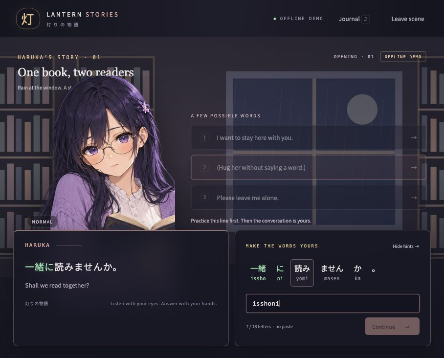
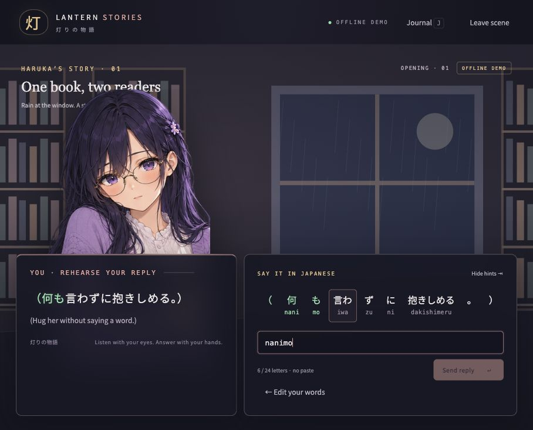
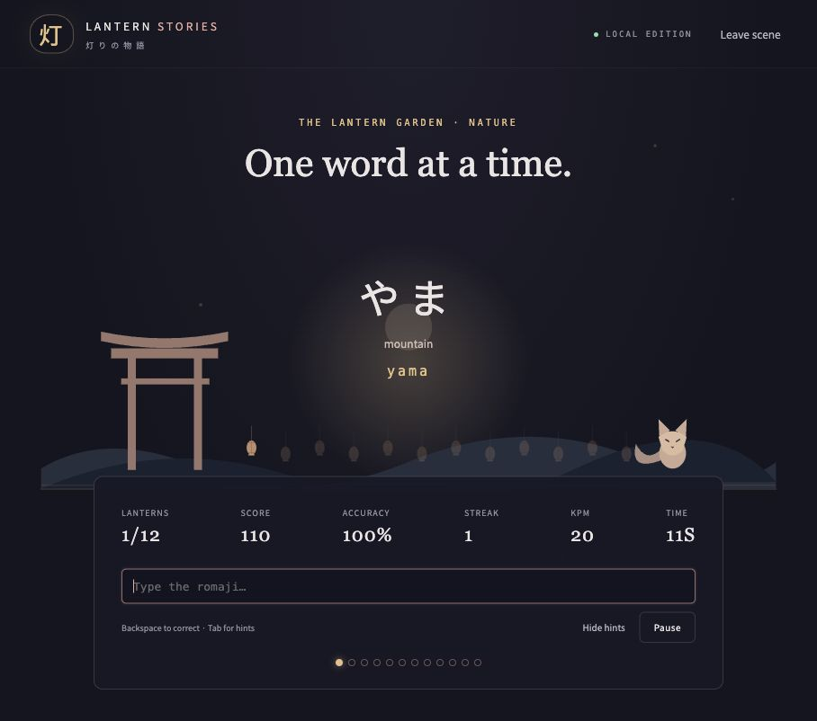

# Lantern Stories · 灯りの物語

**An anime Japanese-learning RPG.** Choose someone to spend time with, follow a small story, and learn to type the Japanese words you share. This is the browser / Node.js migration of Lantern Stories, including its character art, expressions, nine scene openings, and Lantern Garden word game.

**技术栈：HTML、CSS、JavaScript、Node.js 原生 HTTP / Fetch。没有 npm 第三方依赖，也不需要仓颉、华为 SDK、SDL、Python 或编译器。** 图片、字体与游戏内容都已随仓库提供。


## 一键启动 / Run

Download or clone this repository, extract it to a writable folder, then:

| Platform | Start |
| --- | --- |
| **Windows x86_64** | Double-click **`run.bat`** |
| macOS | Double-click **`run.command`**, or run `./run.sh` in Terminal |
| Linux | Run `./run.sh` |
| Node.js 22+ already installed | `npm start` (or `node server.mjs --open`) |

The launcher opens **http://127.0.0.1:8787** in your browser. Keep the terminal open; press **Ctrl+C** there to stop. Use a current Edge, Chrome, Firefox, or Safari. No `npm install` and no build step are needed.

If Node.js 22+ is absent, the launcher downloads the official **Node.js 22.23.1** portable runtime, verifies its SHA-256 against the official checksum list, and extracts it under ignored `.tools/`. The first launch needs internet access to `nodejs.org`; later launches reuse that runtime. Windows uses built-in PowerShell 5.1; macOS/Linux use `curl`, `tar`, and `shasum` or `sha256sum`. On a computer without internet, install Node.js 22+ in advance, or copy the matching official portable runtime into the `.tools/node-v22.23.1-PLATFORM-ARCH/` folder. The Windows directory is `.tools/node-v22.23.1-win-x64/` and must contain `node.exe`.

On macOS, if a ZIP download loses executable permissions, run `chmod +x run.sh run.command` once. If Gatekeeper prevents double-clicking, start `./run.sh` from Terminal. If your terminal cannot find `npm`, use `node server.mjs --open`; the game itself does not use npm.

## API 配置 / Live AI

**无需 API Key 也能评分运行：选择 `Offline demo`。** It includes all nine authored openings, three choices per round, Japanese action translation, expression changes, typing practice, journals, and three six-round endings. It is explicitly labelled; free-form translation requires live AI. The garden always works offline.

For the full AI story and free replies, copy `.env.example` to **`.env`** in the repository root:

```dotenv
DEEPSEEK_API_KEY=your_key_here
DEEPSEEK_BASE_URL=https://api.deepseek.com
DEEPSEEK_MODEL=deepseek-flash
PORT=8787
```

Restart the server, select **Live story**, and choose your translation language: **English / 中文 / Español**. Environment variables override `.env`. The configured model must support OpenAI-compatible chat completions and JSON output. You can change the model or base URL without changing the game; the server appends `/chat/completions` to the base URL.

The API key stays on the local server and `.env` is ignored by Git. Only story context and the replies you submit are sent to the configured provider. No transcript or player message is saved to disk. Reloading, leaving the scene, or restarting clears your current story; idle server sessions expire after two hours. The server listens on `127.0.0.1` only.

## How to play

1. Choose **Yuri** (warm and caring), **Haruka** (shy and bookish), or **Hana** (devoted and playful). Each has three scenes. Characters and openings are predefined; there is no custom character-prompt field. All characters are adults.
2. Read the Japanese line and the small translation. Type its romaji in the bottom-right panel. Each matching Japanese chunk turns **green** in both panels. Backspace undoes progress; incorrect letters do not advance it. Paste and drag-and-drop are blocked in practice fields.
3. Press **Enter / Continue** to unlock the three recommendations. They suggest supportive, unexpected, and distancing directions; the labels do not reveal the outcome. In Live story, write your own reply in any language instead. IME and paste work in the free-reply field; limit 160 characters.
4. The AI translates your words or parenthesized action into Japanese first. Practice that romaji, then press **Enter / Send reply**. Only then does the character answer. You can edit a translated draft before sending; editing requires a fresh translation and practice.
5. The character’s emotion changes the portrait with a **420 ms crossfade**. Every character has normal / loving / angry / shy / sad plus delighted (Yuri), thoughtful (Haruka), or smug (Hana).
6. After six player replies, the AI closes the scene with a Good, Hidden, or Bad ending based on the actual conversation. Practice the final line to see the ending card. Open **Journal** to reread the conversation.





**Keys:** Enter advances a completed practice line; Tab toggles hints while the practice field is focused; 1–3 selects recommendations when outside an editing field; Ctrl/Cmd+Enter translates a free reply; J opens the journal when outside a text field; Esc closes the journal or leaves the story. On narrow screens the panels stack vertically, keeping the practice field usable.

## Romaji rules

The model returns Japanese surfaces with **kana readings**, never authoritative romaji. The application checks that the surfaces concatenate exactly to the Japanese sentence, then computes the romaji locally using one shared converter on server and browser.

- Learning units are lexical words or verb stems, particles, polite auxiliaries, and punctuation. The AI supplies lexical boundaries. The application separates recognizable attached grammatical endings on kanji-containing chunks. Kana-only lexical words such as **この** and **もっと** stay together; **ません** stays together.
- Example: **一緒 / に / 読み / ません / か / 。** → **issho / ni / yomi / masen / ka**. Type `isshoniyomimasenka`; spaces, case, and punctuation are ignored.
- Use `shi`, `chi`, `tsu`, `fu`, `ji`, `sha`, `cha`, etc. Isolated particles は / へ / を use **wa / e / o**. Greetings こんにちは / こんばんは use **konnichiwa / konbanwa**.
- Small っ doubles the following consonant, including across adjacent learning chunks: 待っ / て → **mat / te**. A punctuation boundary stops that bridge. Long ー repeats the previous vowel: コーヒー → **koohii**. Kana おう remains **ou**. ん is **n**; apostrophes are optional separators.
- A Japanese unit turns green only when its complete corresponding romaji has been typed. Punctuation has no keystrokes.

This is a learning-oriented chunking convention, **not a full morphological analyzer**. Kanji pronunciation depends on the AI’s kana reading; alignment, kana conversion, punctuation, grammatical suffix handling, and progress boundaries are validated locally. An invalid AI response produces a retryable error instead of entering the story.

## The Lantern Garden

A separate offline mode carries over **48 words** in Nature, Everyday, and Greetings. Each round samples 12 distinct words. Quiet practice has no time limit; Challenge lasts 90 seconds. Light a lantern for each word, build a streak, and review what you learned. Accuracy and keystrokes per minute are measured locally. Alternate spellings such as `shi/si`, `chi/ti`, and `fu/hu` are accepted where listed. For an ambiguous completed spelling such as `hon` / `honn`, press Enter after `hon`, or finish typing `honn`. Pause freezes the clock; Esc pauses/resumes a round.



## Development and validation

```sh
npm test
npm run check
# If npm is not available:
node --test
node --check server.mjs
node --check public/app.mjs
# Start without opening a browser:
node server.mjs
# Test the portable macOS/Linux launcher without opening a browser:
./run.sh --no-open
```

The Node test suite covers all 9 × 3 scene/language combinations, all three endings, practice gates, literal actions, retry transactions, stale requests, emotion and choice validation, bounded memory, romaji boundaries, garden scoring, and HTTP configuration/secret protection. An optional [GitHub Actions template](docs/ci.github-actions.yml) runs the suite on Windows, macOS, and Linux with Node.js 22. Copy it to `.github/workflows/test.yml` to enable it using a GitHub credential with workflow permission. See [validation notes](docs/validation.md) for the verification performed for this migration.

Project layout:

| Path | Purpose |
| --- | --- |
| `server.mjs` | Local HTTP server, `.env`, static files and API routes |
| `lib/sessions.mjs` | Authoritative story state; transactional translation/reply steps |
| `lib/provider.mjs` | Short DeepSeek prompts and structured-response validation |
| `lib/memory.mjs` | Compact summary, pinned opening, recent turns and related older turns |
| `lib/demo.mjs` | Explicit authored offline demo |
| `public/` | Buildless browser UI, learning logic, art and fonts |
| `test/` | Node native tests, with no network or API key requirement |
| `run.bat`, `run.sh`, `run.command` | Cross-platform launchers |

The main story prompt is roughly **1,100 characters**. Context is managed by the app: a maximum 360-character factual recap, the opening line, the latest six messages, and up to two related older messages. Older messages are retrieved by shared Han/katakana bigrams. The application validates the emotion enum, exactly one recommendation for each direction, the ending phase, chunk alignment, and length limits. A small translation repair request handles Japanese recommendation labels when the selected translation language differs. A round is committed only when the entire validated response succeeds, so retries preserve practice without duplicating player turns.

**Troubleshooting:** If port 8787 is busy, stop the previous terminal or change `PORT`. AI errors show a retry button; check the key, model, balance, network and base URL. Live errors never silently switch to the authored demo. If Node cannot be downloaded, install Node.js 22+ manually and rerun. The default UI needs no CDN, remote font, native library, or package installation.

## Assets and attribution

Character posters and six-expression atlases are reused from the original Lantern Stories project, generated with ImageGen in Japanese anime style. Exact generation prompts are preserved in `docs/poster-prompts.json`, `docs/poster-prompts.md`, and `docs/expression-prompts.json`. Backgrounds and the shrine/fox garden are drawn locally with CSS/SVG; the atlas crops are rendered with browser canvas. **Noto Sans CJK JP** is bundled under the SIL Open Font License, in `public/assets/fonts/OFL.txt`. Node.js is obtained from its official distribution only when needed; its downloaded runtime includes its own license. No proprietary framework or native SDK binaries are included in this repository.
